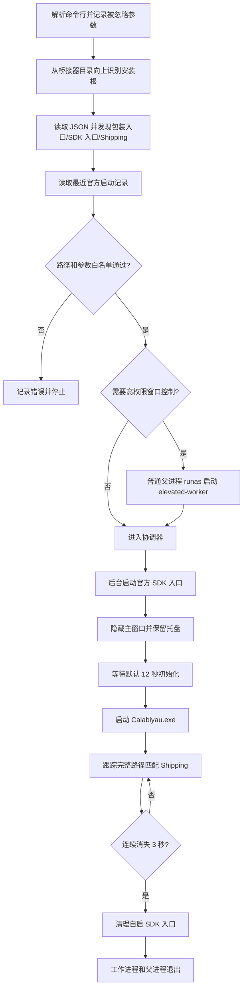
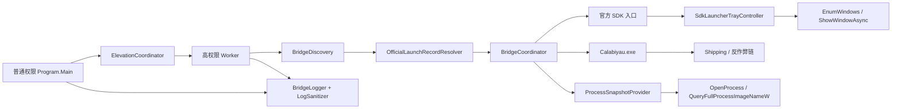

# CalabiyauLaunchBridge 实现原理

本文说明 `CalabiyauLaunchBridge.exe` 当前如何建立《卡拉彼丘》的官方 SDK 和登录上下文、校验启动记录并跟踪游戏生命周期。

当前重构版使用 Windows x64 NativeAOT 发布为原生单文件，运行时组件静态包含在 EXE 中。用户可将带版本号的发布附件直接复制到《卡拉彼丘》安装目录内的任意位置运行，无需安装 .NET、重命名文件或创建配置。

## 为什么需要桥接器

实机验证表明，单独运行深层游戏入口会因缺少官方记录参数出现登录口令错误；只有参数、没有官方入口维持的 SDK 上下文时又会出现 SDK 未初始化错误。因此桥接器需要：

1. 在后台运行安装根目录的官方入口，初始化渠道 SDK、登录缓存和反作弊上下文；
2. 默认等待 12 秒，再用最近一次官方成功启动记录中的白名单参数运行深层包装入口 `Calabiyau.exe`。

这套桥接不是为了绕过官方入口，而是为了保留其必要上下文，同时隐藏主窗口并把真实游戏生命周期稳定暴露给 Steam。直接运行深层 EXE 或只复制参数都不能等价替代官方链。

## 已确认的官方启动流程

2026-10-10 的标准版实机采集确认：安装根目录官方入口以自身目录为工作目录建立登录缓存和渠道 SDK 上下文，并保留托盘宿主；随后以深层包装入口所在目录为工作目录，使用最近一次官方成功记录中的 `-Channel`、`-Lanuch`（官方拼写）、`-AdsPath` 及可选 DX 参数启动 `Calabiyau.exe`，再进入 SGuard 和 Shipping 游戏进程。缺少记录参数时会出现“登录口令过期”，只有参数但缺少后台入口时会出现“未初始化SDK[-12000]”。

2026-10-11 的腾讯版实机采集确认：官方记录可以只包含 `-Channel` 与可选 DX 参数，后台官方入口负责维持腾讯渠道上下文，随后启动 Tenprotect/SGuard 和真实游戏进程。标准版与腾讯版均已完成真实登录、反作弊、游戏退出和后台入口清理验证；这些参数格式仍属于采集结果，不是官方长期兼容承诺。

## 桥接器原理

### 执行链

## 技术栈与框架图

- 语言与运行时：C#、.NET 8 Windows API 表面。
- 发布：Windows x64 NativeAOT 原生单文件，关闭调试符号并以速度为优化目标。
- 系统接口：`System.Diagnostics.Process`、P/Invoke 的进程/窗口 API、ShellExecute `runas`。
- 配置与序列化：`System.Text.Json` 源生成上下文，避免 NativeAOT 依赖运行时反射元数据。
- 并发与生命周期：`async`/`await`、后台托盘窗口监控任务、进程句柄、命名 `Mutex`。
- 安全处理：官方记录正则解析、参数白名单、安装根路径约束和日志参数脱敏。
- 测试：.NET 固定测试宿主与 PowerShell NativeAOT 发布产物测试。

## 代码中如何实现

| 类型 | 实现职责 |
|---|---|
| `Program` / `CommandLineOptions` | 建立日志、解析已知参数、记录并忽略未知参数和 Steam 尾随命令、选择验证或实际运行路径。 |
| `ElevationCoordinator` | 用 `ProcessStartInfo.UseShellExecute` 和 `Verb=runas` 启动高权限 Worker；父进程等待并透传退出码。 |
| `BridgeDiscovery` | 从桥接器目录向上识别最近的官方安装根，再有限递归发现包装入口、SDK 入口和游戏本体；合并 JSON 默认值并对候选评分。 |
| `OfficialLaunchRecordResolver` | 按日志修改时间和行倒序查找记录，核对 EXE 绝对路径及根目录边界，再执行严格参数白名单。 |
| `BridgeCoordinator` | 启动/附着 SDK 入口、等待初始化、启动包装入口、等待 Shipping 出现、执行 3 秒防抖和所有权清理。 |
| `SdkLauncherTrayController` | 后台任务按 PID 与完整路径发现窗口；调用 `EnumWindows`、`ShowWindowAsync` 抑制主窗口显示。 |
| `ProcessSnapshotProvider` / `ProcessExitTracker` | 使用 Win32 句柄核对完整路径并在进程退出后读取真实退出码。 |
| `BridgeLogger` / `LogSanitizer` | 单文件七天保留、会话字段记录，并对 Channel、登录、Token 等值脱敏。 |
| `BridgeInstanceLock` | 对规范化安装根做 SHA-256，生成每个安装目录独立的命名互斥体。 |

## 路径和启动记录

未提供 `--install-root` 时，程序从桥接 EXE 所在目录开始逐级检查父目录，选择最近一个同时包含根目录官方入口及 `log`、`config.ini` 或 `Calabiyau` 安装标记的目录。这个过程只检查祖先目录，不递归扫描磁盘，因此桥接器可放在安装目录内任意层级，同时不会误用某位用户的固定盘符。显式 `--install-root` 始终优先。

确定安装根后，程序在有限深度内分别发现包装入口、用于初始化 SDK 的官方入口和真实 Shipping 游戏进程。各类候选具有独立的文件名、相对路径和路径关键字优先级，并共享排除目录和最大搜索深度，不扫描整个磁盘。JSON 配置和日志仍与桥接 EXE 同级。

若 JSON 没有显式提供 `launcherArguments`，程序读取安装根目录 `log` 文件夹中的官方日志，从新到旧查找启动记录。记录中的 EXE 必须与当前发现的包装入口完全一致、仍然存在并位于安装根目录内。

参数白名单只接受 `-Channel`、官方拼写的 `-Lanuch`、`-AdsPath`、`-dx11` 和 `-dx12`。标准版记录必须包含前三项；腾讯版可以只包含 `-Channel` 和可选图形参数，因为登录上下文由后台 SDK 入口维持。渠道、登录、令牌等敏感参数值写入日志前会替换为 `<redacted>`。

## 权限和窗口控制

官方入口以高完整性级别运行时，普通权限进程不能可靠控制它的窗口。桥接器因此采用父子进程结构：Steam 启动普通父进程，父进程通过 `runas` 启动 `--elevated-worker`，然后持续等待工作进程，从而保持 Steam 所见的生命周期连续。

高权限工作进程轮询完整路径匹配的官方入口窗口，并用 Win32 API 隐藏主窗口但保留托盘宿主和后台 SDK。启动后的前 20 秒采用高频检查，随后降低频率。窗口控制只针对路径匹配或由桥接器亲自启动并登记的 PID。

## 进程与生命周期

`--attach-only` 不建立新的 SDK 上下文，只附着或等待已有游戏。正常模式先确保官方 SDK 入口存在，并只对本次桥接器启动的入口记录所有权；初始化等待结束后再运行包装入口。

真实游戏进程先按名称筛选，再核对完整路径，避免误附着到其他安装中的同名进程。桥接器为发现的游戏 PID 保留进程句柄，以便退出后读取退出码。目标游戏连续消失默认 3 秒后结束会话。

清理阶段只关闭由本次桥接器启动的官方 SDK 入口；用户原本已经运行的入口不会被桥接器结束。Steam `%command%` 展开的原始命令被作为尾随载荷整体忽略。无法识别的双横线参数同样不会传给官方入口或游戏，而是以脱敏形式写入 `command.arguments_ignored` 日志事件；已知参数缺值或数值越界仍视为配置错误。

## 单实例、配置和日志

安装根目录经规范化和 SHA-256 摘要后用于命名本地互斥体，同一安装目录同时只允许一个桥接器实例，不同安装目录互不影响。

同级 JSON 可覆盖入口文件名、相对路径、启动参数、SDK 初始化等待、搜索深度、超时和退出防抖。日志固定写入 EXE 同级的 `CalabiyauLaunchBridge-log/CalabiyauLaunchBridge.log`，始终使用一个主要日志文件并按条目保留最近 7 天。

## 更新失效边界

如果官方启动记录位置或格式改变、新的必要参数不在白名单、官方入口不能再独立建立 SDK 上下文、SDK 初始化和父子进程关系变化，或反作弊要求只能从官方界面触发，则必须重新实机捕获和修改实现。

更新后应先通过官方启动器成功进入游戏一次，再运行 `--validate` 检查路径和记录，最后验证 UAC、登录、反作弊、托盘隐藏、退出防抖和后台入口清理。

## 自动测试与实机验证边界

v1.3 发布版自动测试确认从安装根、包装入口附近和深层自定义子目录向上识别安装根，以及未知参数、Steam 尾随命令的忽略和日志记录。该版本的目录发现与参数兼容改动尚未在真实标准版、腾讯版或 Steam 客户端中复验。

v1.2 自动测试确认标准版和腾讯版目录样本、官方记录白名单、参数脱敏、完整路径进程匹配、真实退出码、3 秒防抖、七天日志以及 NativeAOT 单文件产物。2026-10-10 标准版和 2026-10-11 腾讯版实机确认覆盖的是 v1.1 的真实登录、SDK 上下文、SGuard/Tenprotect、游戏退出和后台入口清理；构建 v1.2 时本机已无游戏安装，因此 NativeAOT 重构尚未重新完成实机回归。未来版本的新参数、登录状态、反作弊行为和 Steam 客户端跟踪不能仅由固定样本证明，必须重新实机验证。

主要实现：[`Calabiyau/src/Program.cs`](../Calabiyau/src/Program.cs)；固定回归测试：[`Calabiyau/tests/`](../Calabiyau/tests/)。
