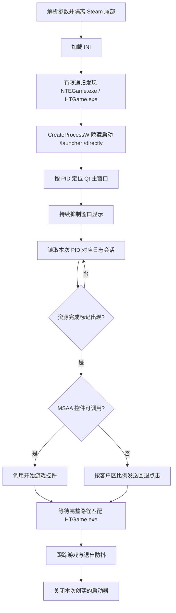
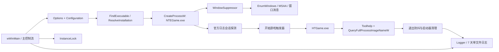

# NevernessToEvernessLaunchBridge 实现原理

本文说明 `NevernessToEvernessLaunchBridge.exe` 当前如何等待《异环》官方资源检查、触发官方“开始游戏”动作并管理启动器与游戏生命周期。

## 为什么需要桥接器

直接使用官方 `/autoplay` 参数虽然能启动游戏，却会绕过资源状态机完成时点，造成音乐和音效正常但所有角色语音缺失。先运行 `/directly`、再启动第二个 `/autoplay` 进程也不会向已有启动器实例传递开始动作。因此纯静态参数不能复现正常流程，桥接器必须等待官方资源检查完成，再触发已有启动器的“开始游戏”动作。

桥接器保留官方资源检查和游戏创建过程，只自动化正确的触发时机、隐藏启动器窗口并管理真实游戏与启动器生命周期，不直接运行 `HTGame.exe`，也不修改官方文件。

## 已确认的官方启动流程

2026-10-12 的国服实机对照采集确认，官方入口以 `/launcher /directly` 启动 `NTEGame.exe` 后，会先完成本地资源检查并将 `localResChecked` 置为完成状态；用户再点击“开始游戏”，启动器从 `Client` 工作目录启动：

```text
HTGame.exe /Game/LoginAndCreate/Map/Updater/Updater_P -SAVEWINPOS=1
```

该流程下角色语音正常。对照采集显示，`/launcher /autoplay` 最终使用相同的游戏本体、参数和工作目录，但启动时点早于本地资源检查完成，全部角色语音缺失。当前结论来自本次国服版本采集和人工语音验证；游戏版本、渠道或资源状态逻辑改变后必须重新验证。

## 桥接器原理

### 执行链



## 技术栈与框架图

- 语言与标准：原生 C++20。
- 平台接口：Win32 进程、窗口、消息、互斥体和 INI API；Microsoft Active Accessibility（MSAA）。
- 标准库：`std::filesystem`、线程、原子状态、正则/字符串、时间、容器和文件流。
- GUI 自动化：`EnumWindows` 定位 Qt 顶层窗口，MSAA 递归查找可调用按钮，Win32 客户区消息作为坐标回退。
- 配置：`GetPrivateProfileStringW` / `GetPrivateProfileIntW` 读取同级 INI。
- 构建：CMake、MSVC、Windows SDK，静态链接 MSVC 运行库。
- 产物：Windows x64 原生单 EXE，清单请求管理员权限并嵌入版本和多尺寸图标资源。



## 代码中如何实现

| 代码位置 | 实现职责 |
|---|---|
| `Options` / `Configuration` | 解析桥接参数和 INI；隔离 Steam `%command%` 尾部，并脱敏记录所有被忽略的未知参数。 |
| `FindPreferredExecutable` / `FindExecutable` / `ResolveInstallation` | 从桥接器目录逐级向上匹配候选相对路径；确定安装根后执行有限递归发现并排除补丁、缓存和重解析点。 |
| `StartProcess` | 组装可变命令行缓冲区，以 `CreateProcessW` 和正确工作目录启动官方入口。 |
| `WaitForWindow` / `WindowSuppressor` | 按启动器 PID、Qt 类名和窗口尺寸锁定主窗口，并由后台线程持续隐藏。 |
| `CurrentSessionReady` | 从最后一个 `Log Init` 会话后核对 PID、启动参数和资源完成标记，拒绝旧会话误命中。 |
| `InvokeAccessibleButton` / `ClickRelative` | 递归 MSAA 树查找“开始游戏”或“开始”并调用默认动作；失败时使用配置比例计算客户区坐标。 |
| `MatchingProcesses` / `ProcessHandle` | 枚举 `HTGame.exe` 后用 `QueryFullProcessImageNameW` 核对路径，并保存句柄读取退出码。 |
| `InstanceLock` | 使用 `CreateMutexW` 防止同一安装范围重复运行。 |
| `Run` / `CloseStartedLauncher` | 依次执行资源等待、点击、启动确认、进程跟踪、防抖和仅限自有启动器的清理。 |

## 路径发现与配置

桥接 EXE 可以位于官方安装根目录或其任意子目录。未显式指定安装根时，程序从 EXE 所在目录逐级向上，只匹配 INI 配置的入口与本体候选相对路径；两者同时命中时将该祖先目录确定为安装根。这个祖先匹配可以跨越任意安装目录深度，但不会递归扫描宽泛的上级目录或整个磁盘。若候选相对路径未命中，程序仍保留原有的有限层级回退发现；EXE 位于游戏安装范围外时可用 `--install-root` 指定。

确定安装根后，程序优先检查 INI 中配置的候选相对路径，再在该安装根的有限深度内按文件名查找；递归过程跳过重解析点以及备份、补丁、下载、缓存和临时目录，不扫描整个磁盘。

默认入口为 `NTEGame.exe`，默认游戏本体为 `HTGame.exe`。同级或 `--config` 指定的 `NevernessToEvernessLaunchBridge.ini` 可覆盖文件名、候选路径、排除目录、搜索深度、官方启动参数、日志相对路径、资源完成标记、按钮名称、回退坐标、窗口策略和各项超时。配置路径必须保持在识别到的安装根目录内。

## 资源状态与窗口触发

桥接器以隐藏窗口方式创建官方入口，并只接受进程完整路径与发现结果一致的 `NTEGame.exe`。Qt 主窗口按本次启动器 PID、顶层窗口尺寸和 `QWindowOwnDC` 类名识别；窗口抑制线程在运行期间持续隐藏它，避免启动和游戏退出时界面弹出。

资源就绪判断读取官方 `NTEGame.log`，从最后一个 `Log Init` 会话向后核对启动参数和 `Process ID`，确保完成标记属于本次启动器而不是旧日志。默认要求 `_setLocalResChecked] 0->1` 与 `onGameElementUpdateFinished] all ready` 两个标记同时出现，不能只凭本地资源检查完成就触发游戏。

确认就绪后，程序先递归检查 MSAA 无障碍树并调用名称为“开始游戏”或“开始”的控件；若官方 Qt 界面没有暴露可调用控件，则向主窗口客户区的配置比例位置发送点击消息。只有在点击后发现新的、完整路径匹配的 `HTGame.exe`，启动才算成功。

## 进程与生命周期

游戏进程先按 `HTGame.exe` 名称筛选，再用 `QueryFullProcessImageNameW` 核对完整路径，避免附着到其他安装中的同名进程。桥接器保存首次发现进程的句柄以读取退出码，并持续观察路径匹配的进程集合；短暂消失不会立即结束，只有连续达到配置的退出防抖时间才进入清理。

清理阶段只处理本次桥接器创建的官方启动器：先向已识别主窗口发送正常关闭请求，等待配置的宽限时间；若官方程序只缩到托盘且配置允许，再终止该启动器进程。启动桥接器之前已经存在的官方入口不会被强制结束。

## Steam 参数与权限

Steam 启动项可使用：

```text
"<异环安装根目录>\NevernessToEvernessLaunchBridge.exe" %command%
```

桥接器先解析自己的 `--install-root`、`--config`、`--validate` 和 `--no-dialog`；遇到首个普通位置参数后，将其及后续内容整体视为 Steam `%command%` 展开的原始命令并隔离。无法识别的 `--xxx` 长选项自动忽略，因此第三方启动器附加参数不会阻止游戏启动；已知但缺少必要值的桥接参数仍会报错。桥接器自身参数必须放在 `%command%` 前面。

所有被忽略的参数都会写入 `arguments.ignored` 日志事件，普通非敏感参数、值和 Steam 传入路径按实际内容记录，便于核对第三方启动器的调用方式。参数名包含 `token`、`cookie`、`password`、`secret`、`auth`、`session`、`ticket`、`api-key` 或 `credential` 等敏感标记时，内联值或紧随其后的独立值会显示为 `<redacted>`；包含敏感赋值片段的普通参数会整体隐藏。

正式 EXE 包含管理员权限清单，以便在相同完整性级别控制官方启动器窗口。产物为 Windows x64 原生 C++ 单文件，并静态链接 MSVC 运行库，不要求用户安装 .NET、Python 或额外 VC++ Runtime。

## 日志与采集工具

日志固定写入 EXE 同级的 `NevernessToEvernessLaunchBridge-log/NevernessToEvernessLaunchBridge.log`，始终使用一个主要日志文件并按条目保留最近 7 天。日志记录运行标识、版本、系统、有效参数、被忽略参数的脱敏摘要、发现路径、官方启动命令、资源状态、窗口触发方式、游戏进程变化、退出码、运行时长和完整原生异常堆栈，不复制官方日志原文或账号数据。

`NevernessToEvernessLaunchCapture.exe` 是只读采集工具，用于游戏更新后记录官方入口、子进程、命令行、工作目录和生命周期，以重新核对真实启动链；它不属于正式桥接附件。

## 更新失效边界

普通版本目录变化和有限层级调整通常可由路径发现或 INI 覆盖适配。如果官方更改资源日志格式、完成标记、Qt 窗口结构、开始按钮位置、入口或本体名称、游戏参数、工作目录、进程接力方式、登录上下文或反作弊要求，则必须重新运行采集工具并完成实机验证，不能只依赖自动测试。

更新后应依次验证官方手动启动与角色语音、桥接器隐藏触发、UAC、登录和反作弊、Steam `%command%`、游戏退出防抖、托盘启动器清理以及日志中的完整生命周期。

主要实现：[`NevernessToEverness/src/main.cpp`](../NevernessToEverness/src/main.cpp)；示例配置：[`NevernessToEverness/examples/NevernessToEvernessLaunchBridge.ini`](../NevernessToEverness/examples/NevernessToEvernessLaunchBridge.ini)；固定测试：[`NevernessToEverness/tests/`](../NevernessToEverness/tests/)。

## v1.1：错误提示与失败恢复（2026-10-22）

保留原有英文错误及日志路径，追加按错误原因区分的中文排查提示。资源检查超时提示检查游戏是否更新；重复实例、路径或配置错误、启动器退出、窗口控制失败、游戏未出现和日志写入失败分别提示对应处理方法。

修复失败后官方启动器仍被隐藏的问题：在异常退出、显示错误框之前，先停止窗口抑制线程，再按本次确认的启动器 PID 请求恢复 Qt 主窗口。此恢复适用于桥接器创建及附着的启动器，不强制结束已有启动器，也不自动下载更新。恢复请求数量记录在 `launcher.failure_recovery`；若窗口已经退出或被替换而无法找到，可从官方托盘入口打开或退出启动器后重开。正常游戏退出仍使用原有关闭策略。

实机日志确认：2026-10-17 国服启动器检测版本 1.4.10 → 1.4.15，需下载 2321 MB，仅完成本地资源检查而未出现 `all ready`，桥接器等待超时并在重试时附着同一启动器。代码确认旧版异常路径只停止隐藏线程、不恢复窗口；用户实机反馈确认旧版失败后无法重新打开启动器；2026-10-22 用户反馈修复版超时与窗口恢复现象符合预期，未单独提供完整采集。

自动测试确认：Release 构建、隐藏 Qt 测试窗口异常恢复（连续两次重试）、恢复后不再被隐藏、正常作用域不恢复窗口、中文提示分类，以及原有路径发现、单文件、多尺寸图标、日志位置、七天保留和错误堆栈检查通过。固定入口为 `tests/Test-Bridge.ps1`，窗口恢复测试实现为 `tests/RecoveryTests.cpp`。真实官方更新界面恢复、登录、角色语音、反作弊和 Steam 生命周期尚未完成本次实机复测。
### v1.1：重复双击重新接管（2026-10-22）

正常启动时，先用安装范围对应的重启互斥体串行化接管，再枚举进程：仅对完整路径位于已识别安装根目录内、且 EXE 版本资源 ProductName 确认为 NevernessToEvernessLaunchBridge 的其他进程执行结束并等待退出，包括旧版及版本后缀文件。随后接管原有安装互斥体，开始新一轮桥接；`--validate` 不会结束其他桥接器。旧进程终止会关闭其错误弹窗和隐藏线程，事件记录为 `bridge.restart_previous`。失败时追加中文提示退出旧进程并检查权限。

不结束游戏、官方启动器或更新任务。若官方启动器仍隐藏，新进程按完整路径附着；再次失败时请求恢复窗口。若游戏已经运行，新进程按完整路径跟踪至游戏消失并完成退出防抖，不重复启动；此接管分支不再拥有旧桥接器的启动器句柄，因此游戏退出后不强制清理该启动器，游戏退出码暂不可用。安装根以外的旧桥接器不自动结束；应将桥接器放在各自游戏安装范围内使用。重启桥接器会使 Steam 观察到旧桥接器退出，Steam 在线状态连续性尚未实机验证。

自动测试已覆盖真实子进程持有安装互斥体时结束旧进程、接管被遗弃的互斥体，并通过 Release 编译、单文件与图标、发现路径、日志保留、错误堆栈及失败窗口恢复回归。真实游戏已运行时的跟踪、旧版弹窗接管、更新中的官方启动器与 Steam 生命周期尚需实机复测。测试入口仍为 `tests/Test-Bridge.ps1`，新增进程接管样本位于 `tests/RecoveryTests.cpp`。