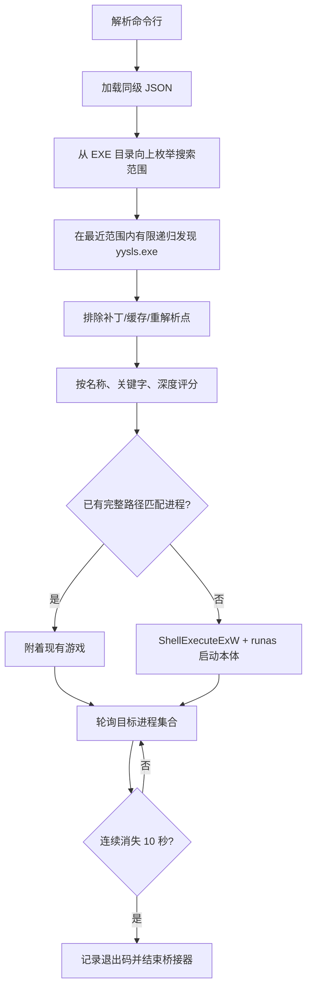
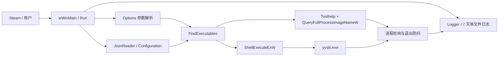

# WhereWindsMeetLaunchBridge 实现原理

本文说明 `WhereWindsMeetLaunchBridge.exe` 当前的路径发现、启动和生命周期管理方式。v1.3 起主程序使用原生 C++20、Win32 API 和静态 MSVC 运行库构建为 Windows x64 单文件，不依赖 .NET 或额外 VC++ Runtime；v1.4 起支持放在安装目录树的任意子目录并忽略、记录未知启动参数。

## 为什么需要桥接器

《燕云十六声》的真实游戏本体位于会随版本或安装形态变化的深层目录，标准版、极速版以及后续版本可能使用不同的 `Win64r`、`Win64rh` 或其他层级。把某个当前绝对路径直接添加到 Steam，更新后容易失效；只跟踪官方启动器又不能稳定代表真实游戏进程的完整生命周期。

桥接器提供一个位置稳定的入口，在有限安装范围内动态发现本体，使用已采集的官方参数启动或附着到完整路径匹配的现有游戏，并在真实游戏退出防抖结束前保持运行。它不伪造 Steam 状态，也不替代登录或反作弊，只让外部程序跟踪桥接器所维持的真实游戏会话。

## 已确认的官方启动流程

2026-09-26 对当时的官方启动器进行实机采集，确认最终游戏入口为 `yysls.exe`，工作目录为该本体所在目录，关键启动参数为：

```text
yysls.exe --launch-type=launcher
```

2026-10-14 对标准版再次实机采集，确认官方启动器中的“使用 DirectX 11 启动”会把 `Win32/deploy/setting.ini` 保存为 `DX12=false`；游戏命令仍是 `yysls.exe --launch-type=launcher`，运行进程加载了 `d3d11.dll`。随后从 Steam 启动桥接器时仍保持 `DX12=false`。Steam 展开的尾随命令中观察到 `--commandline-dx12-control=0`，但桥接器将其作为 Steam 原始尾随载荷忽略并记录，DX 模式由官方启动器保存的配置决定。取消该勾选并通过官方启动器成功启动一次，会恢复 `DX12=true`。

以上采集确认的是官方启动器向游戏本体交接时的最终命令、工作目录和 DX 配置变化，没有把上游登录和反作弊内部实现当作已知事实。当前桥接器复用已确认的本体参数，但官方没有承诺该参数为长期公开接口；UAC、登录、反作弊和 Steam 生命周期仍需要在游戏更新后实机复核。标准版真实目录已验证，极速版目前只有固定目录样本和路径测试，不能视为完整实机启动结论。

## 桥接器原理

### 执行链



## 技术栈与框架图

- 语言与标准：原生 C++20。
- 平台接口：Win32 API，包括 Toolhelp 进程快照、`OpenProcess`、`QueryFullProcessImageNameW`、`ShellExecuteExW` 和 Win32 错误格式化。
- 标准库：`std::filesystem`、容器、时间、异常和文件流。
- 配置：源码内轻量 JSON 解析器，不依赖第三方 JSON 运行库。
- 构建：CMake、MSVC、Windows SDK，Release 静态链接 MSVC 运行库。
- 产物：Windows x64 原生单 EXE，资源脚本嵌入版本、清单和多尺寸 ICO。



## 代码中如何实现

| 代码位置 | 实现职责 |
|---|---|
| `Options` / 参数解析函数 | 解析已知桥接器参数；未知、缺值或无效参数被忽略并记录，遇到 Steam 展开的普通位置参数后隔离整个尾部。 |
| `JsonReader`、`Configuration` | 解析并校验同级 JSON，生成文件名、参数、排除目录、关键字和搜索深度配置。 |
| `DiscoverInstallation` / `FindExecutables` | 从 EXE 目录向上寻找最近的共同范围，用 `std::filesystem` 做总深度受限的递归发现，排除重解析点和缓存目录，并计算候选顺序。 |
| `FindProcesses` | 先按文件名枚举进程，再用 `QueryFullProcessImageNameW` 与候选绝对路径集合比较。 |
| `StartGame` / `ProcessHandle` | 通过 `ShellExecuteExW` 请求 UAC，并用 `SEE_MASK_NOCLOSEPROCESS` 保存进程句柄和退出码。 |
| `Run` | 串联发现、附着/启动、500 ms 轮询、启动超时和 10 秒退出防抖。 |
| `Logger` | 追加 ISO 8601 会话日志，并在启动和运行期间清除 7 天前条目。 |

## 路径发现

若未提供 `--install-root`，程序从桥接 EXE 所在目录开始，最多向上枚举 32 个祖先范围，并在每一级按 `maxSearchDepth` 进行有限递归搜索；找到候选后立即采用最近的共同范围，不再继续扩大搜索。因此桥接器可以位于游戏安装目录树中的任意常规子目录，而游戏本体相对候选范围的向下搜索深度默认仍限制为 12 层。程序不会搜索磁盘根目录，也不会进行无边界全盘扫描。

每个范围都跳过重解析点和 `Patch`、`BinPatch`、`Backup`、`Download`、`Temp`、`Cache` 等目录。若显式提供 `--install-root`，则只搜索该范围，不再向上查找。实际尝试过的全部范围写入 `Discovery scopes` 日志。

候选使用软评分排序：JSON 中靠前的 `executableNames` 优先；包含 `preferredPathKeywords` 的路径优先，默认偏好 `Win64r` 和 `Win64rh`；层级较浅的路径略优先。版本目录名、`Engine\Binaries` 和 `Win64r`/`Win64rh` 都不是必须结构。

### 启动方式

若不存在完整路径匹配的已运行游戏，桥接器选择评分最高的候选，以本体目录作为工作目录，通过 `ShellExecuteExW`、`runas` 和 `SEE_MASK_NOCLOSEPROCESS` 执行：

```text
"<发现的 yysls.exe>" --launch-type=launcher
```

同级 `WhereWindsMeetLaunchBridge.json` 可覆盖本体文件名、启动参数、排除目录、路径关键字和搜索深度。`--variant` 只按目录片段筛选候选，不接受绝对路径。Steam `%command%` 展开的原始命令被作为尾随载荷整体忽略。

已知且有效的桥接器参数正常生效。未知长参数、已知参数缺值或参数值无效时，桥接器不中断启动，而是将其加入 `ignoredArguments` 日志；遇到第一个普通位置参数后，将该参数及其全部尾随内容视为 Steam 原始命令并忽略。日志会保留参数的顺序用于诊断，但对名称疑似包含 token、Cookie、password、session、secret 或 key 的参数值进行脱敏。

### DX11 / DX12 选择

桥接器不提供独立的 DX 强制参数，也不读取后覆写官方配置。用户应先在官方启动器中选择模式并成功启动一次游戏：

- 勾选“使用 DirectX 11 启动”并成功进入一次游戏，官方配置写入 `DX12=false`，之后从桥接器启动会沿用 DX11。
- 取消该勾选并成功进入一次游戏，官方配置写入 `DX12=true`，之后从桥接器启动会沿用 DX12。

这样可以保留官方启动器对显卡能力、配置文件和后续版本兼容性的管理。若游戏更新后该选项或配置语义发生变化，应重新通过捕获器做实机采集，不能假定旧映射永久有效。

## 进程与生命周期

程序从候选路径提取进程名，再用 `QueryFullProcessImageNameW` 读取同名进程的完整路径。只有路径属于候选集合的进程才算游戏，避免误附着到其他安装中的同名进程。

主动启动返回的进程对象也参与存活判断，以覆盖启动初期路径暂时不可读的情况。游戏出现后，目标进程连续消失达到默认 10 秒防抖才结束；主动启动进程的退出码会作为桥接器退出码返回。

## 配置与日志

同级 [`WhereWindsMeetLaunchBridge.json`](../WhereWindsMeet/examples/WhereWindsMeetLaunchBridge.json) 可覆盖本体文件名、启动参数、排除目录、候选关键字和搜索深度；路径值保持相对安装范围，不需要保存用户盘符。所有生效配置、忽略参数、搜索范围和候选选择都会进入诊断日志。

日志固定写入 EXE 同级的 `WhereWindsMeetLaunchBridge-log/where-winds-meet-launch-bridge.log`，始终使用一个主要日志文件并按条目保留最近 7 天。

## 更新失效边界

普通目录和版本号变化通常可自动适配。本体改名或参数变化可先用 JSON 覆盖；若官方增加新的环境变量、登录上下文、反作弊初始化，禁止直接启动本体，或改成新的多进程接力方式，则需要重新捕获启动链并修改实现。

更新后应先通过官方启动器成功进入游戏，再运行 `--dry-run` 检查路径、工作目录和参数，最后实机验证 UAC、反作弊和 Steam 生命周期。

构建使用 CMake 和 MSVC，主目标静态链接 C/C++ 运行库并嵌入多尺寸游戏图标、版本资源、Windows 10 兼容清单和长路径声明。Release 目录中的 `WhereWindsMeetLaunchBridge.exe` 即为完整运行文件；同级 JSON 仅在需要覆盖默认发现或启动参数时才需提供。

自动测试确认：Release 原生编译、单文件产物、标准版/极速版/任意目录样本发现、桥接器从任意安装子目录向上发现、补丁缓存排除、JSON 改名配置、未知参数忽略与脱敏日志、Steam 尾随命令隔离、日志位置、7 天条目保留以及异常类型、消息和原生地址栈。实机采集确认包括 2026-09-26 标准版官方启动链，以及 2026-10-14 官方启动器 DX11 配置变化、`d3d11.dll` 加载和随后通过 Steam 启动桥接器仍沿用 DX11；取消勾选后的 DX12 配置映射已确认，DX12 模块加载与 v1.4 的完整登录、UAC、反作弊、极速版启动和 Steam 生命周期尚需目标电脑复验，不能由自动测试替代。

源码：[`WhereWindsMeet/src/main.cpp`](../WhereWindsMeet/src/main.cpp)；示例配置：[`WhereWindsMeet/examples/WhereWindsMeetLaunchBridge.json`](../WhereWindsMeet/examples/WhereWindsMeetLaunchBridge.json)；固定回归入口：[`WhereWindsMeet/tests/Test-PathDiscovery.ps1`](../WhereWindsMeet/tests/Test-PathDiscovery.ps1)。
